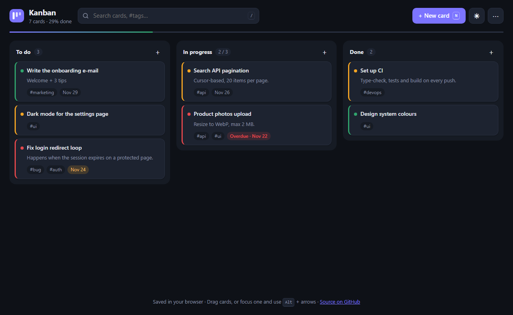

# Kanban

[](https://github.com/NissemBatMan/kanban/actions/workflows/ci.yml)


**A fast, offline-first Kanban board.** No account, no server: your board is saved in your browser.

### ▶ [Live demo](https://nissembatman.github.io/kanban/)



## Features

- **Drag & drop** cards between columns and inside a column, with a drop marker showing where the card lands
- **Keyboard first**: <kbd>N</kbd> new card, <kbd>/</kbd> search, <kbd>Enter</kbd> edit, <kbd>Alt</kbd> + arrows to move the focused card
- **Priorities, tags and due dates**, with *soon* and *overdue* badges
- **Instant search** across titles, notes and `#tags`, ignoring case and accents
- **Work-in-progress limit** on the "In progress" column, highlighted when exceeded
- **Rename columns** with a double-click
- **Light & dark themes**, following your system by default, with no flash on load
- **Export / import** the whole board as JSON; imported files are validated and repaired
- **Accessible**: native `<dialog>`, labelled controls, visible focus, reduced-motion support
- **Responsive**: columns snap horizontally on phones

## Tech

React 19 · TypeScript (strict) · Vite · plain CSS with custom properties · Vitest · GitHub Actions → GitHub Pages

All board logic lives in [`src/board.ts`](src/board.ts) as **pure functions** (a reducer plus validation),
so every rule (moves, reordering, cleaning input, repairing imports, search, due dates) is unit-tested
without a browser.

```
src/
├── board.ts          # model, reducer, validation, search (pure, tested)
├── demo.ts           # demo board with dates relative to today
├── App.tsx           # state, persistence, shortcuts, import/export
└── components/
    ├── ColumnView.tsx  # drop zone + drop position
    ├── CardView.tsx    # draggable card, keyboard moves
    └── CardEditor.tsx  # add / edit dialog
```

## Run locally

```bash
npm install
npm run dev        # http://localhost:5173
npm test           # unit tests
npm run build      # type-check + production build in dist/
```

## License

MIT © Nissem
